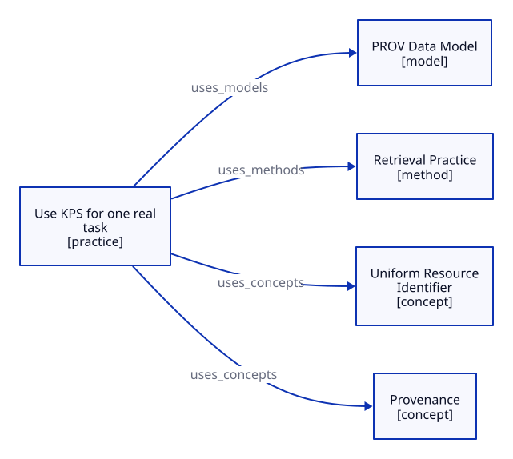

# Use KPS knowledge neighborhood

## Key takeaway

Read arrows as declared use relationships, not evidence of causation or a compulsory reading order.

## Summary

This small graph starts from one Practice and includes its direct Concept, Model and Method dependencies. It is generated from current YAML metadata, not from a second manually maintained knowledge taxonomy. Explanatory diagrams inside documents remain the priority.

## Read this neighborhood

The [Use KPS Practice](practices/use-kps.md) declares use of [Provenance](concepts/provenance.md), [Uniform Resource Identifier](concepts/uniform-resource-identifier.md), [Retrieval Practice](methods/retrieval-practice.md) and the [PROV Data Model](models/prov-data-model.md). The edge labels reproduce `uses_concepts`, `uses_methods` and `uses_models`. They do not mean that every step requires all four documents or that a Method has been validated by its presence on the graph.

This is a one-hop view. Reference records, indirect dependencies and other Practices are intentionally omitted. Ordinary Markdown links above supply navigation; clickable SVG nodes are not required.

[Editable generated D2 source](diagrams/knowledge-map/use-kps-dependencies.d2). Update the owning documents' metadata, then regenerate; do not add unsupported edges to the D2 file.
