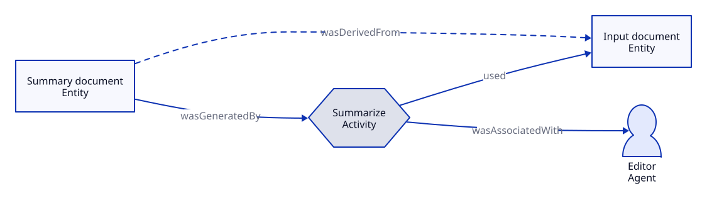

# Provenance

## Key takeaway

Provenance describes production history rather than certifying truth.

## Summary

W3C provenance vocabulary identifies the entities, activities and people or systems involved in producing something.

## Meaning

Provenance records how an entity was produced or changed and which activities and agents were involved. A citation alone supplies less detail than such a history.

## Example

A report derived from a spreadsheet can name the spreadsheet version, calculation activity and analyst. If the spreadsheet contained an error, the same history would still describe its production. The history and the truth assessment therefore answer different questions.

## Production history does not certify truth

The source is used by an activity; its output is generated by that activity, and an agent bears an associated responsibility. The derived-from relation records a dependency, not correctness. This is the same synthetic subset drawn in the PROV Model, embedded here so its meaning is available without opening another file. A faithfully recorded history can still describe an inaccurate output.

[Editable D2 source](../diagrams/models/prov-relations.d2). Source basis and limits remain in this document.

## Boundary

This is an explanation of production provenance, not a legal chain-of-custody assessment. No KPS record automatically implements every PROV constraint. A meaningful source trail should distinguish the inspected material from a later interpretation; the local recording choices are made in Practices.

## Source alignment

[prov-dm](../references/w3c-2013-prov-dm.md) — Sections 2.1 and 2.2. Alignment: definition-paraphrase. This is a scoped explanation, not institutional endorsement or certification of KPS. The source does not define KPS file roles.
