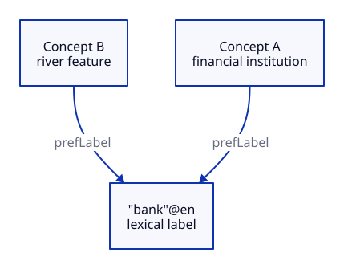

# SKOS Concept

## Key takeaway

A SKOS concept is distinct from the words used to label it.

## Summary

This is the knowledge-organization sense specified by W3C, not a universal psychological definition of thought.

## Meaning and boundary

SKOS represents an idea or notion as a resource; lexical labels name it. Identical wording need not establish identical meaning. A KPS Concept file is our document role, not automatically an instance of the complete SKOS data model.

## Example

In a synthetic vocabulary, the label “bank” could name a financial institution or a river feature. Separate identities and scope descriptions make the intended sense inspectable. Renaming a label does not by itself create a new subject.

## Different identities can share a label

This synthetic vocabulary gives two distinct concepts the same label, bank in English. The arrows mean prefLabel; they do not assert equivalence between the concepts. Compare scope and identity rather than spelling. This is an original illustration of the lexical distinction, not a complete SKOS serialization or a copied W3C figure.

[Editable D2 source](../diagrams/concepts/concept-and-label.d2). Source basis and limits remain in this document.

## Use and limits

Compare definitions and scope, not just spelling, before reusing terminology. This example is explanatory, not a prescribed dictionary entry or a claim of equivalence between vocabularies. KPS-specific classification belongs in the domain-building Practice.

## Source alignment

[skos](../references/w3c-2009-skos-reference.md) — Sections 3 and 5. Alignment: definition-paraphrase. This is a scoped explanation, not institutional endorsement or certification of KPS. The source does not define KPS file roles.
