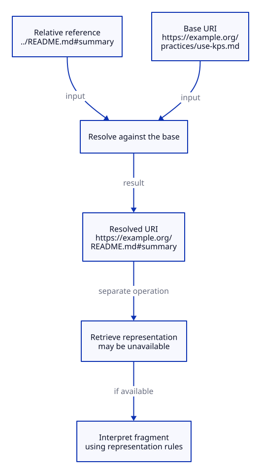

# Uniform Resource Identifier

## Key takeaway

Identification does not imply successful retrieval.

## Summary

RFC 3986 supplies URI terminology and syntax; Markdown destinations and internal KPS IDs use only particular parts of that setting.

## Meaning and representation

A URI identifies a resource. A relative reference needs a base for resolution. A fragment identifies a secondary resource according to the representation's rules; RFC 3986 does not generate Markdown heading slugs.

## Example

From `practices/use-kps.md`, the reference `../README.md` resolves relative to that file, not a reader's home directory. The local ID `kps:pr:use-kps` is not thereby a navigable section of the Markdown document.

## Resolution is not retrieval

In this synthetic example, base `https://example.org/practices/use-kps.md` plus `../README.md#summary` resolves to `https://example.org/README.md#summary`. The two inputs are needed together. Resolution does not fetch the file or prove that summary is a valid fragment. The representation and viewer determine fragment interpretation; RFC 3986 does not create Markdown heading slugs. The domain and paths are illustrative, not requested network resources.

[Editable D2 source](../diagrams/concepts/uri-resolution.d2). Source basis and limits remain in this document.

## Boundary and use

Distinguish identity, display title and address when repairing a link. The complete KPS slug policy and its file operations belong to the authoring contract and Practices. This explanation is not a complete browser URL algorithm or a promise that the resource stays available.

## Source alignment

[uri](../references/ietf-rfc3986-2005-uri-syntax.md) — Sections 1.1, 3.5 and 5. Alignment: definition-paraphrase. This is a scoped explanation, not institutional endorsement or certification of KPS. The source does not define KPS file roles.
