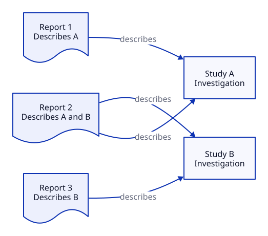

# Author useful D2 diagrams

## Key takeaway

Add a diagram only when it resolves a real reading or execution difficulty; preserve the complete explanation in the owning document.

## Summary

This guide implements [AUTHORING.md](authoring.md), rather than introducing another knowledge type or a parallel authoring standard. D2 is the preferred editable source and its generated SVG is the publication image. The [Core-wide audit](../diagrams/audit.json) records a decision for all 20 objects, with 17 explanatory sources and one small metadata graph. Shared diagrams have one editable source; there is no per-file quota. Reading needs neither a D2 installation nor a hosted diagram service.

## Original diagrams retained

| Owning content | What the diagram makes explicit |
|---|---|
| [Study and Report](../concepts/study-and-report.md) | A report can describe multiple studies and one study can have multiple reports |
| [Study Level Evidence Independence](../principles/study-level-evidence-independence.md) | Repeating the same participants and outcome in reports is not repeating the trial |
| [PROV Data Model](../models/prov-data-model.md) | The direction and meaning of four named provenance relations |
| [PDCA](../methods/pdca.md) | A checked result feeds a new improvement decision instead of guaranteeing rollout |
| [Use KPS](../practices/use-kps.md) | Failed structure, failed navigation and unavailable tests lead to different actions |
| [Knowledge neighborhood](library.md) | Actual declared use relationships around one Practice, with omitted edges disclosed |

These are original explanatory drawings or a metadata view, not copied professional-source figures. Their accompanying text retains source alignment and the limits of synthetic examples. The repository MIT license covers our diagram sources; external publications retain their own rights. Default D2 rendering supplies fonts internally; no separate font files are distributed here.

## Additional explanations

New sources clarify concept labels, URI resolution, indirect evidence, spacing variables, SKOS predicates, PICO comparison, independent extraction, walkthrough prompts, recall records, release gates, repair reach and causal-attribution limits. The [audit](../diagrams/audit.json) links each owner and explains reuse and text-only decisions.

## Add or revise one diagram

1. Identify the exact confusion: a distinction, relation, branch, loop or comparison. If a sentence or small table already does the job, do not add an image.
2. Put a semantic `.d2` file under `diagrams/` in the relevant role subfolder. Register its `source`, `owner` and `reason` in `diagrams.json`. Each SVG is generated beside its source. Write short labels and label arrows by their actual meaning. In particular, a use relationship is not a causal or chronological claim.
3. Embed the SVG beside the relevant explanation or steps. Include useful alternative text, a short reading guide, the important limit, and a source link. Explain every essential relationship in text so the task still works with images hidden.
4. With D2 **0.9.0** available, run `python diagram_tools.py --write`. The configuration pins Dagre, theme and padding. Inspect the rendered result at normal document width; shorten labels or change orientation if the text is too small. Do not edit SVG by hand.
5. Compare text and diagram semantics, run `python diagram_tools.py --check` and the normal checks, and review affected local summaries before refreshing their fingerprints. Commit the source and generated SVG together. Rendering success is not semantic approval.

```markdown


Read each arrow as describes, not causes. This is a synthetic example.

[Editable D2 source](../diagrams/concepts/study-and-report.d2)
```

D2 installation is needed only for rendering, not reading. The [official installation guide](https://www.d2lang.com/tour/install/) describes supported installation routes. Use the version in `diagrams.json`, not an unspecified latest renderer. Our Linux CI downloads the fixed release archive and checks its recorded SHA-256 before using it.

## Build and verify

```bash
python diagram_tools.py --write
python diagram_tools.py --check
python test_diagrams.py
python test_diagram_audit.py
python validate.py .
python test_validate.py
python test_alignment.py
```

`--check` renders to temporary files and compares the bytes with the committed SVGs; it never rewrites them. It also regenerates the expected metadata graph in memory. A different renderer version, changed metadata, missing source/owner/output, invalid D2 or a stale render must be corrected rather than accepted by disabling the check. `d2 --check` is a formatting check and is not used as a substitute for this source/render comparison.

The explanatory D2 files are authored, while the one-hop knowledge graph is generated from document metadata. To change that graph, change the justified `uses_*` relationship in its document, not the generated D2. The graph omits References and deeper relationships; there is no attempt to draw the entire repository.

## Review without relying on the image

Read the surrounding text with the image hidden. Can you still distinguish entities, interpret results and choose a next action? Then inspect the image: are the arrows consistent with that text, labels readable, conditions visible and loops unambiguous? A chart of quantities additionally needs real or explicitly synthetic data, units and scales; D2 is not a replacement for an appropriate statistical charting tool.

A failed diagram check may mean missing D2, wrong version, invalid input or stale artifacts. Install the pinned version or regenerate and inspect as appropriate. A successful render cannot prove that a diagram is source-faithful or understandable. Native GitHub image rendering, assistive-technology behavior and an independent reader trial remain distinct checks. Essential navigation stays in ordinary Markdown links rather than SVG interactions.

## Source notes

[D2 documentation record](../references/d2-undated-cli-and-svg-export.md) identifies the official CLI, export and embedding information inspected for this feature. [W3C complex-image guidance](https://www.w3.org/WAI/tutorials/images/complex/) supports a text alternative plus the essential relationships in nearby text; it does not certify this package's accessibility. No mandatory quota of diagrams or chart types follows from either source.

## Core diagram necessity audit

The [machine-readable per-object audit](../diagrams/audit.json) records each knowledge object's diagram decision, explanatory purpose, and source reuse. It is authoritative for audit coverage; avoid maintaining another manually synchronized table. The audit is a record of author judgment, not a requirement that every document contain a graphic or proof of reader comprehension.

The retired `DIAGRAM-AUDIT.md` duplicated this registry with a prose table. To review any object, inspect the owning explanation, the registered D2/SVG files, accessibility text, and the declared limits. Keep reasons and content aligned when a diagram is added, removed, or reused.

