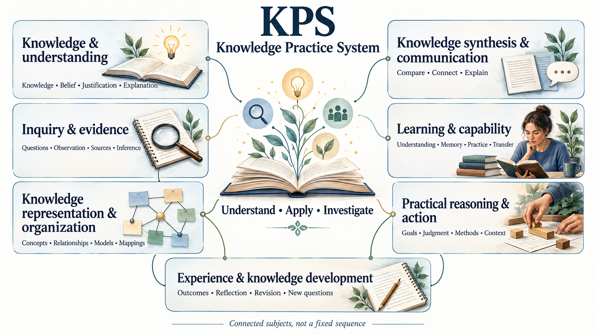

# Reusable authoring templates

## Key takeaway
These are non-normative examples implementing the [authoring contract](authoring.md).

A template supports the job of the knowledge type; it does not prove correctness or require every field to become a file.

## Summary
All objects need identity, meaning, locally sufficient content, scope and support. Copy only the useful fields, replacing placeholders with real content. The examples below are fenced templates, not live published knowledge. Reference records support the five knowledge types rather than becoming a sixth type.

For subject coverage rather than an individual object, use the [body of knowledge outline template](#body-of-knowledge-outline) and its [authoring guide](body-of-knowledge-outline-guide.md).

## Body of knowledge outline

Copy the fenced document into `docs/body-of-knowledge-outline.md` in the domain package. Replace every placeholder and example link with actual content, using the domain's package version. Area and topic names are placeholders, not a prescribed subject structure. Repeat area sections as needed and give their subheadings distinct names. Require one overall summary illustration. Additional subtopic illustrations are optional and chosen by the user; omit them from the default template. Add image links only after the assets exist. This is supporting navigation with no knowledge-object `id` or `type`; it does not replace a Practice.

```markdown
---
package_version: "REPLACE_WITH_DOMAIN_VERSION"
language: "KPS 9.x"
status: "draft"
reviewed: null
---

# Subject Body of Knowledge Outline

## Key takeaway

State what this subject coverage enables the intended reader to understand and do.

## Summary

Describe the selected subject scope and distinguish intended coverage from the
knowledge and Practices already available.

## Purpose and scope

- Audience and starting knowledge: replace with actual readers and prerequisites.
- Learning target: state a concrete capability or set of capabilities.
- Depth and context: state the level, tradition, setting or other relevant limits.
- Optional branches and exclusions: identify what is optional or outside this edition.

## Overall illustration

Embed the required overall summary picture here with descriptive alternative text:



Explain the grouping and any connections. State that this represents intended
coverage, and whether numbers or arrows indicate an actual sequence.
Link the actual editable source or saved generation prompt beside the image.

## Overall outline

| Area | Topics to cover |
|---|---|
| [Area name](#area-name) | Topic name; further topics selected from established accounts |

Use the selected established subject names as area headings. Explain adaptations
and overlap; a convenient visual grouping must not replace those subject names.

## Reading the coverage tables

Understanding names the required knowledge; capability states the intended depth.
Coverage describes available support, not learner competence. Use Missing,
Source only, Partial or Covered at stated depth, with a specific explanation.

## Area name

| Topic | Understand — required knowledge | Be able to do — intended depth | Existing explanations and gaps |
|---|---|---|---|
| Topic name | Relevant meanings, mechanisms, relationships and limits | A bounded explanation, analysis, decision or task | Status; actual links where available; specific missing support |

## Connections across areas

| Connected topics | Relationship and why it matters |
|---|---|
| Selected topics | Explain a dependency, overlap or other meaningful connection |

## Source basis and adaptations

| Established account | Inspected contribution | Selection and limits |
|---|---|---|
| Actual publication Reference link | Located structure or topic contribution and inspected extent | What was selected, adapted, excluded or left provisional |

Explain any locally authored grouping and disagreements between accounts.
Do not imply that a syllabus establishes the effectiveness of a proposed exercise.

## Maintaining the outline

Keep required topics visible before local explanations exist. Update coverage and
explanation links as content develops. Revise the overview and any user-selected subtopic images
when their represented structure changes. The written outline and coverage
tables remain authoritative for topic scope, depth and gaps. Reuse explanations
across topics where useful; do not require one file per topic or one object of
every KPS role. Keep task catalogues and development roadmaps elsewhere.
```

If the user chooses subtopic illustrations, add them beside the relevant coverage sections. Keep subject headings visible, match topic labels to the text, and include alternative text, a scope caption and the saved prompt or editable source. The template does not require pictures for every area or topic.

The [singing worked example](body-of-knowledge-outline-guide.md#worked-example-from-singing) shows how sources, learner targets, coverage and proposed Practices fit together. Use the existing [diagram guidance](diagrams.md) for assets and the package's declared checks for publication.

## Common metadata

Before selecting a template, identify the target Practice, relevant established account and the coherent explanation needed by the reader. A template describes the document's primary job; it does not determine the domain's subdivisions. Include supporting knowledge from other roles inline when needed. Split only for independent use or readability, and retain the relevant source meanings and conditions in overlapping explanations.

```yaml
---
id: "domain:method:meaningful-identity"
type: "method"
version: "1.0.0"
language: "KPS 9.x"
status: "draft"
reviewed: null
uses_principles: []
uses_models: []
references: []
---
```
For the optional dependency-free checker, write metadata values in JSON-compatible YAML as shown. General Markdown content does not depend on that checker.

## Common opening

Use this opening for roles other than Model. Models use the minimal skeleton below.
```markdown
# Meaningful title

## Key takeaway
One useful sentence stating the object itself.

## Summary
What it means, why it matters, how it is used and its main limit.
```

## Concept content
Definition; necessary distinctions; recognizable example and non-example; why it matters; boundaries and evidence; optional deeper links. Do not force procedures into a vocabulary note.

## Principle content
Declarative Statement; explanatory mechanism or relationship; evidence-supported premises; explicit derivation; independently useful applications; limits; possible challenge. Do not disguise a selected instruction as a universal truth. Scientific and domain levels can be metadata; formal or design reasoning must be labelled rather than invented as experiment.

## Model content

Use the common identity metadata with `type: "model"`. The following is a minimal skeleton, not a fixed explanatory outline. Replace the example section and link with subject-appropriate headings.

```markdown
# Model name

A short introduction explaining what this Model helps readers understand
and the scope it covers.

## Contents

- [Subject topic](#subject-topic)

## Subject topic

Explain the relevant parts, properties and relationships. Continue with
headings appropriate to the subject. Place sources and limitations where useful.
```

Before drafting, establish coverage from credible disciplinary accounts and the intended reader outcome. Identify the foundational distinctions needed to understand the Model's parts and relationships; do not infer sufficient coverage from the existing files or a familiar outline. Give important topics recognizable headings or subsections. Develop their explanations enough for the reader to use them in reasoning: mentioning a term or linking elsewhere does not by itself establish coverage. Explain necessary meanings locally and identify significant omissions, assumptions, competing accounts and evidence limits.

Connect the parts through suitable examples or representations, showing how they support an interpretation or conclusion. A recurring example can help, but use separate cases when forcing one example would obscure a distinction. Interfaces explain how representations, constraints or interpretations connect across subsystems; naming the neighboring subsystem alone does not explain the connection.

For a subsystem Model, reconcile coverage with the body-of-knowledge outline. Revise that outline when investigation reveals missing or obscured topics. Explain relevant interactions with neighboring subsystems locally. Components normally stay within their owning subsystem; useful overlap is allowed. Contents should expose important topics using recognizable names and link to the actual sections in their order, with indentation reflecting the heading hierarchy. The outline records required coverage; Contents locates the explanation.

Only the introduction and Contents are structural expectations beyond identity and title. Key takeaway and Summary are optional for Models; an existing Summary may supply the introduction. No fixed topic count, repeated topic template, mandatory interface table, illustration quota or universal processing sequence is imposed. The example below demonstrates reasoning, not a layout to reproduce.

### Example using the PROV Model

The existing [PROV Data Model](../models/prov-data-model.md) supplies a provenance example. The illustration below reuses its selected relationships; the document names and conversion are synthetic. This is an authoring example, not an observed workflow or a complete PROV specification.

**Purpose and entities.** Explain which input a summary came from and who was associated with its production. An Entity has fixed aspects, such as the particular document version being described. An Activity occurs over time, such as converting that document into a summary. An Agent bears responsibility, such as the editor associated with that conversion. The input document and output summary are separate Entities; their identity and version distinguish which materials are being discussed. These example details do not prescribe required PROV attributes.

**Representation and interpretation.** Read each arrow from left to right:

```text
conversion Activity -- used --> input document Entity
summary Entity -- wasGeneratedBy --> conversion Activity
conversion Activity -- wasAssociatedWith --> editor Agent
summary Entity -- wasDerivedFrom --> input document Entity
```

The first relationship identifies the input used by the conversion; the second identifies the Activity that produced the summary. Association records the responsible Agent, and derivation connects the output to its input. Together these statements let the reader trace the summary's production.

**Assumptions and limits.** The illustration assumes that the recorded identities and relationships describe the intended versions and activity accurately. Even then, the summary may misrepresent its input: provenance does not establish correctness. This selected subset omits the full model's other relationships and constraints and is not a formal serialization.

**Evaluation and support.** Ask which Entity was used, which was generated, and whether the graph establishes that the summary is accurate. The supported answers are the input document, the summary, and no. A reversed `used` arrow would change the stated relationship; a claim of accuracy would exceed what this representation establishes. The [PROV Reference](../references/w3c-2013-prov-dm.md) identifies the underlying W3C publication and inspected scope. This walkthrough applies the existing local explanation; it is not a new conformance or independent reader test.

## Method content

> **Template guidance — remove before use:** Follow [Method purpose and depth](authoring.md#method-purpose-and-depth). Explain the established operation sufficiently for its intended use, choosing headings and examples that suit it. Cover necessary conditions, reasoning, actions, result interpretation and limits without treating this list as a fixed layout. Keep contextual selection and authored adaptations in the Practice. An illustrative application is not evidence of effectiveness.

## Practice content

Use the [authoring contract](authoring.md#practice-responsibilities) for required responsibilities and format. The following is a minimal starting point, not a required sequence of supporting headings. Add the common identity metadata with `type: "practice"` and `practice_format: "steps-first-v1"`; the package must declare a minimum compatible checker of 9.1.0 or later.

```markdown
> **Template guidance — remove before use**
>
> Adapt the stage names, number, order and detail to the task. Keep actions,
> essential reasoning, observations and next decisions locally usable.
> Combine these responsibilities where natural; add support only where useful.
> Explain how users judge results and adapt the approach. Include previous
> outcomes when supported, and distinguish proposed from demonstrated improvements.

# Practice name

## Key takeaway

The central action or decision this Practice helps the reader make.

## Summary

The intended outcome, scope and necessary starting conditions.

## Stage map

1. [Stage1 Meaningful action](#stage1-meaningful-action)

## Stage1 Meaningful action

1. Describe an action with the context and reason needed to carry it out.
2. Explain how to interpret its result and choose the next action or finish.

## Current practice summary

Actual application and observations: not recorded.
```

Replace the placeholders and update links as stages are added or renamed. The two numbered lines illustrate combining responsibilities; they are not a two-step requirement. A decision table may be clearer for a branching task. No separate rationale, worked-example, diagram, prompt or record section is compulsory. Keep important limits and source support beside the relevant claim or action.

Draft the target Practice early and refine its actions with the supporting knowledge. For a learning Practice, an output may be an explanation or analysis; state what makes it adequate and what evidence is still missing. Reuse existing explanations without copying their whole documents. Practice composition remains optional and must not create circular containment.

The existing [Use KPS Practice](../practices/use-kps.md) demonstrates a bounded link-repair task with a worked case and conditional decisions. Its particular topic, stage count and illustrations are examples, not additions to the contract. Check a representative normal and uncertain result using the [reader walkthrough](review.md#walk-through-one-stage).

## Reference content
Publication identity, creators, publication or update year and its basis, external URL or DOI, actual access date and extent, located claims, evidence family, limitations and non-claims. Use creator-year-short-title filenames, or `undated` when a date was not established. The record must summarize what the source contributes without requiring immediate external access; it is not a copy of the publication.

## Review before publication
Hide links and attempt the intended use; restore links and check the summary remains faithful. Check claim-source fit, headings and fragments, then run the package checker. [Authoring](authoring.md), [Navigation](authoring.md) and [Compatibility](compatibility.md) provide the complete local maintenance instructions.

## Core source alignment example

```yaml
source_alignment: [{"reference":"kps:r:skos","relation":"definition-paraphrase","locator":"Sections 3 and 5"}]
```

Record the actual source and locator, its meaning and boundary, and any qualification. This declaration is not a formal equivalence mapping. KPS-specific authoring routines belong in Practices rather than new generic Methods. The five role labels remain our local organization.
