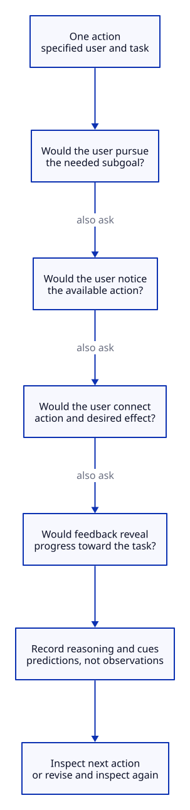

# Cognitive Walkthrough

## Key takeaway

Inspect how a specified user could discover each action and recognize progress.

## Summary

The inspected author guide concerns learning an interface by exploration. Applying the reasoning to a document is a KPS Practice adaptation.

## Inputs and prerequisites

A description of intended users, representative tasks, an interface or prototype and the expected action sequence. An evaluator's expertise must not silently replace the user's assumed knowledge.

## Rationale

An interface can expose the correct action without making its relevance or result understandable to a newcomer.

## Procedure

1. Agree the user knowledge, task and expected route.
2. Inspect each action from that user's perspective.
3. Ask whether the user would pursue the needed subgoal, notice the available action, connect it to the desired result and recognize progress afterward.
4. Record a credible success or failure explanation, including the cues and assumed knowledge.
5. Revise the suspected obstacle and inspect the route again.

## Inspect every action from the user perspective

For each action, inspect all four questions using the specified user knowledge and visible cues. An unexplained or negative answer identifies a predicted difficulty, not a measured failure. Record both credible success reasoning and obstacles, then inspect the next action or revise the design. Continue through all four prompts even after predicting a difficulty; this is not a participant test or a numerical usability score.

[Editable D2 source](../diagrams/methods/walkthrough-action.d2). Source basis and limits remain in this document.

## Synthetic example

An export button exists, but its unfamiliar label gives the novice no reason to choose it. The inspection predicts a learnability problem; it has not measured a failure rate.

## Output and validation

Produce action-specific findings tied to visible cues and user assumptions. An independent reader should be able to reconstruct why the evaluator predicted difficulty. Compare with participant evidence when available.

## Limits

Inspection is not a participant usability study, accessibility certification or measurement of all usability attributes. Do not report evaluator predictions as observed outcomes.

## Source alignment

[walkthrough](../references/wharton-undated-cognitive-walkthrough-report-93-07.md) — Report 93-07, printed pages 2, 3 and 6. Alignment: published-procedure-summary. This is a scoped explanation, not institutional endorsement or certification of KPS. The source does not define KPS file roles.
