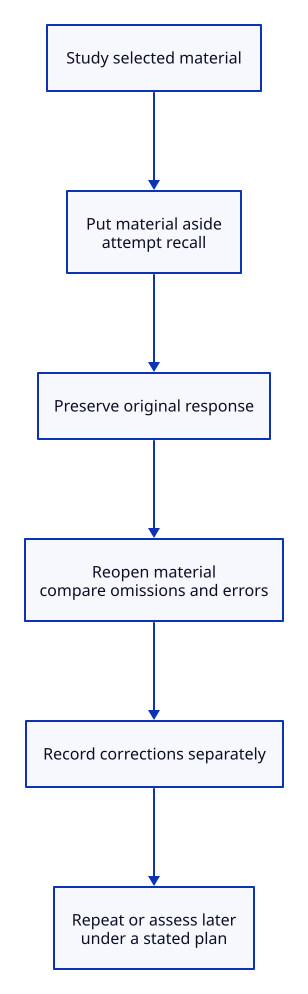

# Retrieval Practice

## Key takeaway

Attempt recall before looking back at the learning material.

## Summary

Retrieval practice is an established learning activity. This file separates its basic operation from evidence about particular comparisons and from KPS study routines.

## Inputs and prerequisites

Material already encountered, an answerable recall prompt and a way to check the response. Recalling confidently is not enough when the reference itself is unreliable.

## Rationale

Recall attempts can contribute to later learning rather than serve only as a measurement.

## Procedure

1. Study the selected material.
2. Put it aside and attempt to retrieve or reconstruct the relevant content.
3. Return to the material to inspect omissions and errors; record what was actually recalled.
4. Repeat or assess later according to the purpose and an explicitly chosen plan.

## Keep recall and checking distinct

The response is produced with the material put aside, then preserved before correction. Checking against the source identifies omissions; a later assessment has its own purpose and conditions. Do not replace the original response with the corrected one or report current familiarity as delayed retention. This illustrates the local operation summarized above, not an optimal schedule or an exact replication of every study procedure.

[Editable D2 source](../diagrams/methods/recall-and-check.d2). Source basis and limits remain in this document.

## Synthetic example

After studying a distinction, write it from memory and then compare the two meanings with the source. This produces an inspectable response rather than a self-rating of familiarity. No learning outcome is asserted here.

## Output and validation

Keep the response, correction and later assessment separate. Evaluate the task that matters, including delayed retention when that is the goal.

## Limits

The number of attempts, feedback, material and schedule vary across studies. This summary is not a universally optimal protocol. Retained evidence includes a methodological re-examination; no superiority over all concept mapping or workplace practice is claimed.

## Source alignment

[mapping-comparison](../references/karpicke-2011-retrieval-and-concept-mapping.md) — Main article experiment procedure on pages 772 and 773. Alignment: published-procedure-summary. This is a scoped explanation, not institutional endorsement or certification of KPS. The source does not define KPS file roles.

[Additional source or qualification](../references/mayrhofer-2023-reexamining-the-testing-effect.md).

[Additional source or qualification](../references/karpicke-2011-spaced-retrieval.md).
