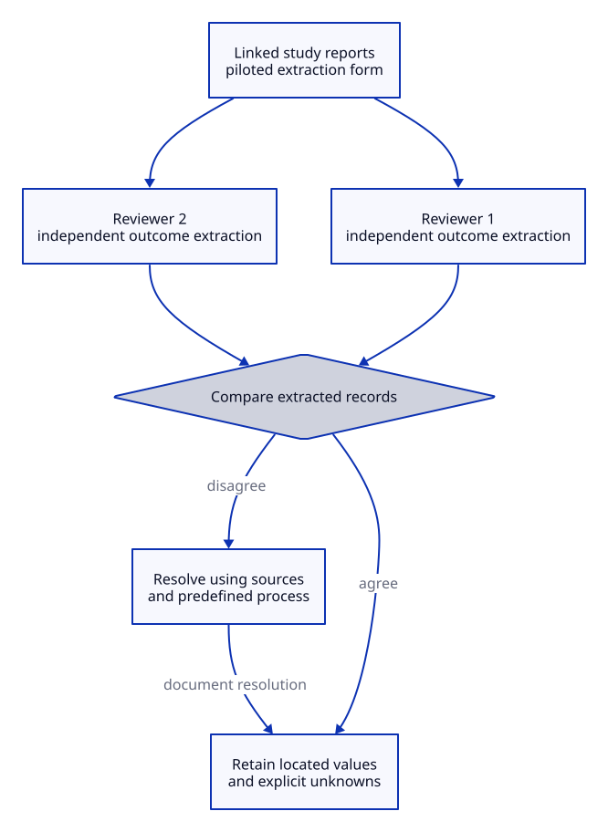

# Study Data Extraction

## Key takeaway

Preserve study information without mistaking reports for separate investigations.

## Summary

This summarizes published Cochrane data-collection guidance, not a claim that a small KPS source scan is a full Cochrane review.

## Inputs and prerequisites

A review question, eligibility decisions, accessible study reports, a data plan and appropriately trained reviewers.

## Rationale

A conclusion cannot be checked if its underlying population, methods and results were silently dropped or duplicated.

## Procedure

1. Identify the studies and link their reports.
2. Define and pilot an extraction form relevant to the planned synthesis.
3. Extract source locations, design, participants, interventions, outcomes and results without filling missing values from expectation.
4. For Cochrane intervention reviews, have at least two people independently extract outcome data; duplicate extraction of study characteristics is highly desirable. Define disagreement resolution in advance and retain the source-based resolution.
5. Keep the extraction record and source links available for later checking.

## Independent extraction before reconciliation

For the Cochrane intervention-review outcome-data step, two people work independently from the linked study reports and planned form before comparing results. Agreement retains source locations; disagreement follows the prespecified resolution process. Unsupported values stay unknown. This does not assert that every KPS note requires two reviewers or that agreement proves correctness. Duplicate study-characteristic extraction is desirable but is not the same mandatory condition as duplicate outcome extraction.

[Editable D2 source](../diagrams/methods/independent-extraction.d2). Source basis and limits remain in this document.

## Working record

| Study | Reports | Located result | Missing information | Check and resolution |
|---|---|---|---|---|
| S1 synthetic | A and B | Not extracted | Unknown | Not performed |

## Validation and counterevidence

Revisit the report and recover each extracted value and its context. Conflicting reports require resolution, not selection of whichever supports the preferred conclusion.

## Limits

A one-person extraction has no independent check. These steps alone do not cover searching, risk-of-bias assessment or statistical synthesis. KPS claim worksheets are adaptations presented in Practices.

## Source alignment

[data-extraction](../references/cochrane-2024-collecting-data-chapter-5.md) — Sections 5.2.1, 5.4 and 5.5; MECIR C45 and C46. Alignment: published-procedure-summary. This is a scoped explanation, not institutional endorsement or certification of KPS. The source does not define KPS file roles.
