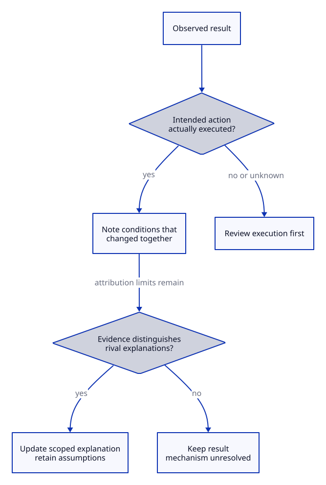

# Review an application and retain justified learning

## Key takeaway

A useful review changes the smallest justified claim or action while preserving what actually happened.

## Summary

Use this Practice after a real application of knowledge. Reconstruct the record, compare explanations, decide whether to revise anything, and identify the next check. Do not convert a successful outcome, a memorable story or a generated example into evidence of a universal effect.

The recommended stage order supports a review, not a compulsory sequence. Prerequisites are access to the relevant record and permission to use it. If no real record exists, perform a clearly labelled planning exercise instead. Personal and sensitive information belongs outside public knowledge repositories.

## Stage map

1. [Stage1 Reconstruct the record](#stage1-reconstruct-the-record)
2. [Stage2 Compare explanations](#stage2-compare-explanations)
3. [Stage3 Select the smallest warranted revision](#stage3-select-the-smallest-warranted-revision)
4. [Stage4 Define the next check](#stage4-define-the-next-check)

## Stage1 Reconstruct the record

Begin with evidence of execution, not the explanation you remember.

**Steps**

1. Identify the task, knowledge version, intended action and expected outcome. Preserve the original record or link to it in permitted private storage.
2. Separate actual inputs and observations from later interpretation. Note deviations from the intended procedure and information that was not collected.
3. Check whether the recorded outcome measures the original goal. A corrected link measures navigation, not learning or trust.
4. Leave missing fields unknown. Do not reconstruct precise timings or successful execution from memory when the record does not support them.

**Synthetic review example**

| Record | Kind | What it can establish |
|---|---|---|
| The author changed a heading fragment | Action | What was attempted |
| The link reached the section in one viewer | Observation | Behavior in that condition |
| Readers now understand the concept better | Interpretation without a test | Not established by the click result |

No real user result is reported by this example. It shows why an apparently successful task may support a narrower conclusion than the review first suggests.

**Production history and interpretation:** A source URL is not proof of the claim. The [PROV model](../models/prov-data-model.md) offers vocabulary for what was used, produced and attributed; our record additionally distinguishes observation from interpretation. A revised interpretation does not require rewriting the original observation. If the record itself is corrected, preserve the correction's provenance and reason.

## Stage2 Compare explanations

Ask what else could produce the observed outcome.

**Steps**

1. Write the leading explanation and at least one plausible rival when causal attribution matters. Consider changed inputs, task difficulty, familiarity, environment or observation method.
2. Identify which conditions changed together. An improved result after a wording change does not isolate wording when the task and assistance also changed.
3. Write what observation would distinguish the explanations. If none is available, retain the practical result while leaving the causal explanation unresolved.
4. Consult additional sources only for the specific uncertainty. Trace multiple reports back to their shared origin before treating them as independent support.

**Interpretation route**

```text
Observed result
      |
      +-- Intended action not executed -> review execution first
      +-- Several conditions changed  -> limit attribution
      +-- Rivals predict same result  -> keep mechanism unresolved
      +-- Distinguishing evidence      -> update the scoped claim
```

The diagram is an authored reasoning aid, not a statistical causal test. [Cochrane's studies and reports guidance](https://www.cochrane.org/authors/handbooks-and-manuals/handbook/current/chapter-05) helps inspect shared evidence origins; it does not settle the causal question for an individual application.

**Do not turn an outcome into a cause**



This authored review route summarizes Stage2. First verify actual execution. Then note changes that limit attribution and ask whether available evidence distinguishes rival accounts. When it does not, keep the observed result but leave the mechanism unresolved. Distinguishing evidence permits only a scoped update under its assumptions, not universal causation. Multiple concerns can apply at once.

[Editable D2 source](../diagrams/practices/attribution-check.d2). Source basis and limits remain in this document.

## Stage3 Select the smallest warranted revision

Choose a change proportionate to the record.

**Steps**

1. Classify the finding as a wording gap, execution problem, unsupported assumption, evidence limitation or changed context.
2. Use the decision table below to select a target. Preserve the original observation even when the interpretation changes.
3. Rewrite the local explanation or action with the relevant conditions. Do not turn a personal preference into an imperative Principle.
4. Compare affected summaries and examples against the revised claim before updating their review fingerprints.

| Finding | Revision target | Avoid |
|---|---|---|
| Undefined term blocked execution | Local definition or Concept | Rewriting unrelated Methods |
| Procedure omitted a necessary input | Method or Practice step | Assuming the whole theory failed |
| Source supported a narrower population | Claim scope and summaries | Keeping the old generalization |
| Outcome did not distinguish explanations | Record uncertainty and next test | Choosing the most fluent story |
| No meaningful new information | No knowledge change needed | A ceremonial release |

## Stage4 Define the next check

Make the next review answerable rather than promising general improvement.

**Steps**

1. State one unresolved question, the observation needed and what would change the decision. Choose a safe paper exercise if actual execution would be inappropriate.
2. Record the proposed conditions and who has authority to act. Do not run or schedule anything merely because it appears in a template.
3. Keep the next check small enough to interpret. When comparing document versions, note whether familiarity, task or assistance differs; do not infer a causal effect from unmatched attempts.
4. Write the review outcome as keep, revise, reject, unresolved or no further action, with its reason. Reopen it only when the question or evidence changes.

**Blank review record**

```text
Application and version:
Actual observation:
Leading explanation and rival:
Revision with its scope:
Next check or stopping reason:
```

If the reader cannot tell what decision the next check might change, narrow it or stop. More testing is not automatically more useful knowledge.

**Separate learning from task execution:** If the objective is delayed recall, try [retrieval practice](../methods/retrieval-practice.md) and record the response before reopening the source. If the objective is executing a procedure, test the action and interpretation instead; remembering a heading is not enough. Select any review spacing as a local, revisable choice. The [spacing finding](../principles/spacing-effect.md) does not prescribe a universal calendar, and the [testing-effect evidence](../principles/testing-effect.md) contains comparator and outcome qualifications. No actual learner result is supplied here.

## Current practice summary

No application record, demonstrated improvement or next experiment is supplied. Fill the record from actual permitted use; keep synthetic examples labelled.

## Deeper knowledge

The following files explain the external meanings and procedures used above. Their selection, adaptation and KPS workflow remain our application.

- [Retrieval Practice](../methods/retrieval-practice.md)

- [Plan Do Check Act](../methods/pdca.md)

- [PROV Data Model](../models/prov-data-model.md)

- [Testing Effect](../principles/testing-effect.md)

- [Spacing Effect](../principles/spacing-effect.md)

[Authoring contract](../AUTHORING.md) defines the local file roles. [Alignment and migration](../ALIGNMENT.md) distinguishes external meaning from KPS design.
