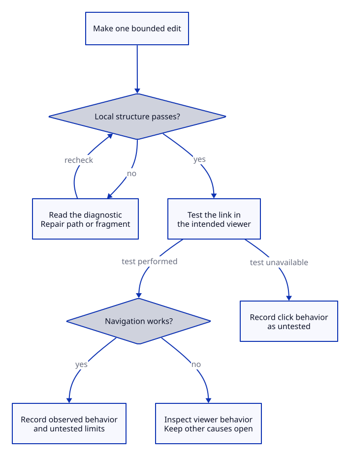

# Use KPS for one real task

## Key takeaway

Leave with a usable answer and an honest record, not a collection of links.

## Summary

Use this Practice to answer one bounded question, apply the relevant knowledge, and decide what needs revision. Concepts define terms, Principles explain relationships, Models represent them, Methods supply operations, and Practices combine those operations. References identify supporting publications; they are not evidence merely because they have a URL.

Stage numbers show recommended order. Actual prerequisites and authorization govern entry: reading about a physical or production-system operation does not authorize it. The example below is a synthetic Markdown repair, not an account of your work.

## Stage map

1. [Stage1 Bound the task](#stage1-bound-the-task) — select an answerable question.
2. [Stage2 Retrieve and inspect the local explanation](#stage2-retrieve-and-inspect-the-local-explanation) — obtain usable reasoning.
3. [Stage3 Use and observe](#stage3-use-and-observe) — try a bounded action and check it.
4. [Stage4 Update the smallest justified target](#stage4-update-the-smallest-justified-target) — preserve the result without overgeneralizing.

## Stage1 Bound the task

Write what needs to change before choosing a tool or building a library.

**Steps**

1. Record the question, context and finish condition in one sentence. For example: “Make the stage-map link reach the intended section in this Markdown viewer.”
2. Separate the observed symptom from your explanation. “Clicking the link does not scroll” is an observation; “the viewer is broken” is a hypothesis.
3. State the permitted scope. For the example, work in a copy of one document; do not rename an entire repository or change access settings.
4. List the missing information that could change the repair: the literal link, the complete heading, and the reader being used.

**Working note**

```text
Question: Why does the stage-map link not reach the section?
Known: The link uses #stage1; the heading contains additional words.
Unknown: Does this viewer generate the agreed heading identifiers?
Done when: The link reaches the section and other local links still work.
```

If the question is actually about an unsafe action or missing permission, stop at explanation or seek the necessary assistance. If several unrelated outcomes are mixed together, choose one before continuing.

## Stage2 Retrieve and inspect the local explanation

Start with the file that answers the question. Do not require yourself to traverse every Concept and Reference first.

**Steps**

1. Read a candidate Method or Practice and restate the action, reason and limit without following its links. If a critical term is undefined, supply that definition locally or mark the document unsuitable.
2. Distinguish a source-supported premise from a KPS convention. In this example, the package's profile constructs a lowercase, hyphenated fragment from the complete simple heading; a YAML object ID does not supply the destination.
3. Locate the exact supporting section when verification matters. For this example, [GitHub section-link documentation](https://docs.github.com/en/get-started/writing-on-github/getting-started-with-writing-and-formatting-on-github/basic-writing-and-formatting-syntax#section-links) describes GitHub's behavior, not every Markdown application.
4. Write the smallest candidate repair and one alternative explanation. If the target heading exists and the fragment already matches, investigate viewer behavior instead of inventing another anchor.

**Example repair**

```markdown
Before: [Capture a record](#stage1)
After:  [Capture a record](#stage1-capture-a-record)

## Stage1 Capture a record
```

**Decision guide**

| What you find | Appropriate action |
|---|---|
| Target file does not exist | Correct the relative path or restore the intended file |
| File exists but fragment does not match a heading | Correct the complete fragment |
| Both match but the viewer does not navigate | Test its actual heading-link support |
| The instructions only say “see another file” | Add the missing local procedure before use |

The table is a troubleshooting aid, not proof of the cause. The essential repair is shown here; the [Reference record](../references/github-undated-markdown-formatting.md) supplies deeper provenance.

## Stage3 Use and observe

Make one bounded change and check whether it was actually applied.

**Steps**

1. Save the original text and record the expected result before editing. In the example, the prediction is navigation to the named section, not improved reader comprehension.
2. Apply the fragment correction to the working copy. Use the package checker from the repository root: `python validate.py .`.
3. Read the diagnostic, not just the exit code. A missing-target error concerns the file; a missing-fragment error concerns the heading. Resolve the reported location without disabling the check.
4. Render the document in the intended reader and click the repaired link. Record the viewer, document version, result and anything not tested.

**Observation route**

```text
Edit made -> structural check -> click in intended viewer
                 |                        |
               fails                    fails
                 v                        v
          inspect diagnostic       inspect renderer behavior
```



This expands the text route above. Failed local checks lead to a path/fragment repair and another check. Passing them permits a viewer test; failed navigation leaves the cause open, while an unavailable viewer must be recorded as untested. Only an observed success supports recording that navigation worked. This is our KPS repair workflow, not a general rule supplied by an external standards body.

[Editable D2 source](../diagrams/practices/check-and-observe.d2).

The diagram separates textual validity from actual navigation. A passed checker cannot establish that a person understands the instructions. If rendering is unavailable, report “structurally checked; click behavior untested” rather than success.

## Stage4 Update the smallest justified target

Keep observation, interpretation and revision separate.

**Steps**

1. Record what happened, including an inconclusive result. Do not overwrite the original symptom with the explanation adopted later.
2. Change only the justified target: a link, local instruction, qualification, or reusable Method. A one-file repair does not justify a universal claim about all renderers.
3. Check the files that summarize the changed object. Preserve their essential instructions and conditions; only then refresh dependency fingerprints with `python validate.py . --accept-reviewed-summaries`.
4. Choose the next action: retain the repair, revise it, investigate a competing explanation, or stop because the task is complete.

**Small record to copy**

```text
Task and version:
Action actually taken:
Observed result and conditions:
Interpretation and competing explanation:
Decision and next check:
```

Keep personal or sensitive records outside public packages. Reusable knowledge should contain an appropriately scoped explanation, not identifying details or a fabricated successful session.

**Canonical content and dependent summaries:** Independently edited copies can disagree. For example, changing A without changing B leaves different values. This reasoning supports our maintenance choice; it is not a W3C mandate to use one repository. Keep a reusable account and concise local summaries where they aid execution. Review each affected summary when a dependency changes. A fingerprint detects changed bytes, not a false interpretation. Preserve previous observations as records even when the current explanation changes.

## Current practice summary

Actual task, observations, interpretation and next check are not recorded. Fill them only from a real application, preferably in a private record. The worked link example is illustrative.

## Deeper knowledge

The following files explain the external meanings and procedures used above. Their selection, adaptation and KPS workflow remain our application.

- [Retrieval Practice](../methods/retrieval-practice.md)

- [PROV Data Model](../models/prov-data-model.md)

- [Uniform Resource Identifier](../concepts/uniform-resource-identifier.md)

- [Provenance](../concepts/provenance.md)

[Authoring contract](../docs/authoring.md) defines the local file roles. [Alignment and migration](../docs/alignment.md) distinguishes external meaning from KPS design.
