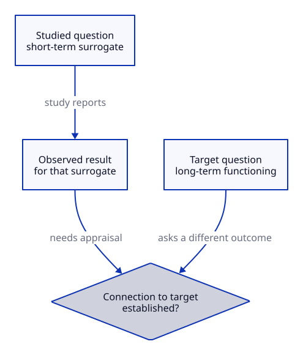

# Indirectness Limits Applicability

## Key takeaway

Evidence relevant to one intervention question does not automatically answer another.

## Summary

This relationship is grounded in the GRADE discussion of indirectness, with its clinical review scope retained.

## Statement

Differences between the evidence question and target question can reduce confidence in applying an effect estimate to the target.

## Reasoning and example

A synthetic study of a short-term surrogate does not directly establish a long-term functional benefit. An additional connection between the outcomes is needed. The same issue can arise when participants or comparisons differ.

## The evidence to target gap

The study and target boxes deliberately differ in outcome and timing. The question between them is an evidential gap, not a proven biological mechanism. A short-term surrogate result may be relevant without directly establishing long-term functioning. State the missing connection and retain uncertainty; this schematic does not assign a GRADE certainty rating, recommend treatment, or reject all indirect evidence.

[Editable D2 source](../diagrams/principles/evidence-to-target.d2). Source basis and limits remain in this document.

## Interpretation

The sensible conclusion may be “useful but indirect,” not automatic acceptance or rejection. State the difference that matters rather than replacing it with a prestige score for the source.

## Limits

No complete GRADE rating or automatic engineering transfer is established here. KPS-specific applicability decisions are worked through in Practices, where proposed adaptations can be examined.

## Source alignment

[indirectness](../references/cochrane-2024-certainty-chapter-14.md) — Section 14.2.2 discussion of indirectness. Alignment: methodological-relationship. This is a scoped explanation, not institutional endorsement or certification of KPS. The source does not define KPS file roles.
