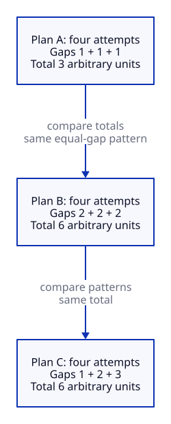

# Spacing Effect

## Key takeaway

Spacing is an experimental variable, not a universal calendar rule.

## Summary

The retained evidence concerns repeated retrieval and delayed retention; it does not define the best review interval for every learner.

## Statement

The inspected experiment found benefits of increased absolute spacing between retrieval attempts, without an inherently superior relative schedule in that comparison.

## Explanation

Total spacing and the pattern of spacing are different variables. A claim about one cannot silently become a claim about the other.

## Example

If two proposed review plans differ both in number of attempts and in elapsed time, their results do not isolate a spacing effect. A learner can compare bounded plans, but the observations must remain separate from the published result.

## Different spacing variables

These are synthetic arithmetic examples, not the study schedules or learning results. Four attempts have three gaps: A uses 1 + 1 + 1 units, B uses 2 + 2 + 2, and C uses 1 + 2 + 3. A versus B changes total spacing while keeping an equal-gap pattern; B versus C keeps a total of 6 but changes the pattern. Units are arbitrary. No plan is recommended, and no retention magnitude, superiority or optimal delay is encoded.

[Editable D2 source](../diagrams/principles/spacing-variables.d2). Source basis and limits remain in this document.

## Limits

Current inspection is abstract-level. No exact schedule, dose or workplace transfer is prescribed. The principle does not establish swimming skill acquisition, a universal scheduling algorithm or a benefit from revisiting every note.

## Source alignment

[retrieval](../references/karpicke-2011-spaced-retrieval.md) — Indexed abstract, experiment on absolute and relative retrieval spacing. Alignment: scoped-empirical-finding. This is a scoped explanation, not institutional endorsement or certification of KPS. The source does not define KPS file roles.
